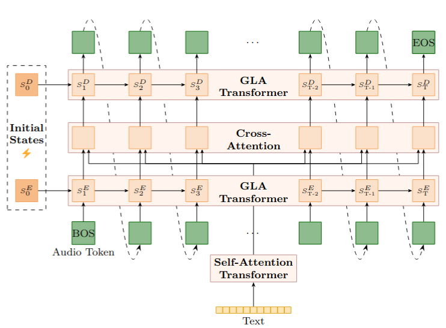

<audio controls preload="none" src="{{ src }}"></audio>

<td class="utt">{{ name }} · {{ extra }}{{ text }}</td>


  
{{ subtitle }}

  

    <strong>Théodor Lemerle</strong>1, Harrison Vanderbyl2, Vaibhav Srivastav3,
    Nicolas Obin1, Axel Roebel1
  

  
1IRCAM, STMS Lab · 2RWKV Foundation, EleutherAI, Recursal AI · 3Hugging Face

  

    <a class="pill" href="https://proceedings.mlr.press/v312/lemerle26a.html">{{ icons.paper | safe }}PMLR</a>
    <a class="pill" href="https://arxiv.org/abs/2410.23320">{{ icons.arxiv | safe }}arXiv</a>
    <a class="pill" href="https://github.com/theodorblackbird/lina-speech">{{ icons.github | safe }}Code</a>
  

  

    

      Lina-Speech replaces self-attention with <strong>Gated Linear Attention</strong>. Because the model is
      recurrent, a voice can be cloned by tuning its <strong>initial state</strong> on several speech excerpts,
      instead of squeezing a single short prompt into the context window.
    

  

  <figure class="demo__figure">
    
  </figure>

<section id="ist">
  <h2>Initial-state tuning vs prompt continuation</h2>
  
Cloning from <strong>multiple speech excerpts</strong> captures finer details of a speaker's identity than a single prompt. All speakers are <strong>unseen</strong>. VoiceCraft's target text is cropped when needed because of its limited context window.

  
<table>
    <thead><tr>
      <th>Speaker &amp; text</th><th>Original</th>
      <th class="is-ours">Lina-Speech<small>initial-state tuning</small></th>
      <th>Lina-Speech<small>prompt continuation</small></th>
      <th>VoiceCraft<small>prompt continuation</small></th>
    </tr></thead>
    <tbody>
    
    
    <tr>
      {{ speaker(row.speaker, row.text_target) }}
      <td>{{ play(base + "original.wav") }}</td>
      <td class="is-ours">{{ play(base + "ist.wav") }}</td>
      <td>{{ play(base + "no_ist.wav") }}</td>
      <td>{{ play(base + "voicecraft.wav") }}</td>
    </tr>
    
    </tbody>
  </table>

</section>

<section id="expresso">
  <h2>Expresso: speaking styles vs Parler-TTS</h2>
  
Evaluation samples from the paper. Samples are <strong>unseen</strong> by Lina-Speech, and an initial state is tuned for each (speaker, style) pair. Parler-TTS Mini was fine-tuned on Expresso.

  
<table>
    <thead><tr>
      <th>Speaker, style &amp; text</th><th>Reference</th>
      <th class="is-ours">Lina-Speech<small>initial-state tuning</small></th>
      <th>Parler-TTS Mini<small>text description</small></th>
    </tr></thead>
    <tbody>
    
    <tr>
      {{ speaker(row.speaker_id, row.text_target, row.style) }}
      <td>{{ play("/assets/demo_lina/expresso/" + row.speaker_id + "_" + row.style + "_example.wav") }}</td>
      <td class="is-ours">{{ play("/assets/demo_lina/expresso/" + row.id + "_lina.wav") }}</td>
      <td>{{ play("/assets/demo_lina/expresso/" + row.id + "_parler.wav") }}</td>
    </tr>
    
    </tbody>
  </table>

</section>

<section id="libritts">
  <h2>LibriTTS vs Parler-TTS</h2>
  
Evaluation samples from the paper. Speakers are <strong>seen</strong> during training by both models.

  
<table>
    <thead><tr>
      <th>Speaker &amp; text</th><th>Reference</th>
      <th class="is-ours">Lina-Speech<small>initial-state tuning</small></th>
      <th>Parler-TTS Mini<small>text description</small></th>
    </tr></thead>
    <tbody>
    
    <tr>
      {{ speaker(row.speaker, row.text_target) }}
      <td>{{ play("/assets/demo_lina/ltts_gpt/" + row.id + "_example.wav") }}</td>
      <td class="is-ours">{{ play("/assets/demo_lina/ltts_gpt/" + row.id + "_lina.wav") }}</td>
      <td>{{ play("/assets/demo_lina/ltts_gpt/" + row.id + "_parler.wav") }}</td>
    </tr>
    
    </tbody>
  </table>

</section>

<section id="zeroshot">
  <h2>Zero-shot voice cloning by prompt continuation</h2>
  
Evaluation samples from the LibriTTS test split. Speakers are <strong>unseen</strong> during training.

  
<table>
    <thead><tr>
      <th>Speaker &amp; text</th><th>Prompt</th>
      <th class="is-ours">Lina-Speech</th>
      <th>VoiceCraft</th><th>StyleTTS 2</th><th>VALL-E X<small>Plachtaa</small></th>
    </tr></thead>
    <tbody>
    
    
    <tr>
      {{ speaker("Speaker " + row.speaker_id, row.text_target) }}
      <td>{{ play(base + "prompt.wav") }}</td>
      <td class="is-ours">{{ play(base + "lina.wav") }}</td>
      <td>{{ play(base + "voicecraft.wav") }}</td>
      <td>{{ play(base + "styletts.wav") }}</td>
      <td>{{ play(base + "vallex.wav") }}</td>
    </tr>
    
    </tbody>
  </table>

</section>
